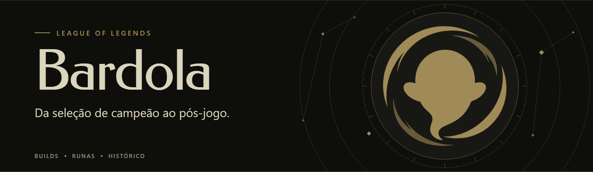
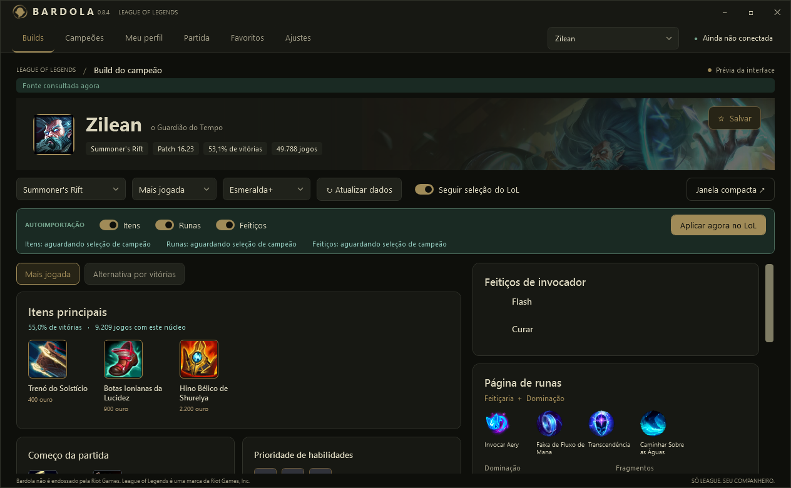

# 

O **Bardola** é um companheiro independente de League of Legends para Windows, em português, sem anúncios e sem Overwolf. Na seleção de campeão, ele prepara suas runas, feitiços e itens. Depois do Nexus, mostra o que você e os dois times fizeram na partida.

**[Baixar Bardola para Windows x64](https://github.com/robertfxbr/Bardola/releases/latest/download/Instalar-Bardola.exe)** · [Como instalar](#instalar) · [Notas da versão](https://github.com/robertfxbr/Bardola/releases/latest)



*Zilean em Summoner’s Rift. A tela mostra o patch, o número de partidas da amostra e os controles individuais de importação.*

## Na seleção de campeão

- **Escolha com o seu repertório.** A aba **Partida** sugere campeões para sua função no Rift. Ela considera sua maestria e seu elo, os bans e os adversários já confirmados. Os dados de confronto entram na sugestão a partir de 100 partidas.
- **Veja de onde vem a build.** Filtre por campeão, modo, função, elo e patch. Compare as variantes pela fonte e pela amostra antes de escolher qual levar para a partida.
- **Leve a build para o cliente.** Ative itens, runas e feitiços separadamente e escolha o Flash no D ou no F. O Bardola guarda backup da página de runas reutilizada. Você também pode salvar favoritos, exportar conjuntos de itens e importar arsenais do Blitz em JSON.

## Durante a partida

No **ARAM: Desordem**, o overlay mostra o tier de cada carta para o campeão que você está jogando. Ele reconhece títulos em português e inglês no modo sem bordas. Para as **curas do ARAM**, calibre as posições em Ajustes e segure **Tab** para sincronizar os tempos visíveis no placar. No Rift, a rota inicial e os cronômetros da selva usam os recursos nativos do LoL.

O painel opcional reúne seus **CS por minuto**, os próximos itens e a prioridade de habilidades. Você pode consultá-lo em modo sem bordas ou no segundo monitor. [Guia de feitiços e cronômetros](docs/feitiços-e-cronometros.md)


### Para quem transmite

Em **Ajustes → Modo ghost**, o espírito fica em contorno e os overlays ganham o selo **GHOST**. Você continua vendo o Bardola no seu monitor enquanto o Windows oculta suas janelas nas capturas compatíveis. Confira a prévia do seu gravador. Se o Windows recusar a proteção do overlay de cartas ou de curas, o Bardola oculta esse overlay.

## Depois do Nexus

O **placar** reúne os dois times, itens finais, cartas, participação nos abates, dano por tipo e dano mitigado. Abra **Linha do tempo** para rever os abates, estruturas e objetivos disponíveis no histórico.

Em **Meu perfil → Campeões**, filtre por campeão e fila para acompanhar vitórias, KDA e desempenho. Com o LoL fechado, a última sincronização fica disponível no PC. Com a API configurada, você também pode consultar um Riot ID do Brasil e comparar seu KDA com a amostra da mesma região e fila nos últimos 30 dias. [Como configurar a API de perfis](docs/api-perfis.md)

## Instalar

1. Use **Windows 10 x64 (2004 ou posterior) ou Windows 11 x64** com o [.NET Desktop Runtime 10 para Windows](https://dotnet.microsoft.com/download/dotnet/10.0).
2. Baixe e execute o [instalador do Bardola](https://github.com/robertfxbr/Bardola/releases/latest/download/Instalar-Bardola.exe). A instalação funciona offline e dispensa permissões de administrador.
3. Abra **Bardola** pelo menu Iniciar. Na primeira consulta, conecte-se à internet para carregar as builds e as imagens oficiais. O app mantém um cache local para consultas seguintes.

As atualizações assinadas chegam em segundo plano e preservam suas preferências e favoritos. Para conferir na hora, abra **Ajustes → Atualizar versão**. Quando o pacote estiver pronto, o botão oferece reiniciar na nova versão.

## Estado do projeto

O Bardola está em desenvolvimento. A importação tem cobertura de testes de protocolo. A validação em seleção real de campeão e do painel durante uma partida segue pendente. Mudanças nas interfaces locais do LoL e nas fontes de builds podem afetar a compatibilidade. Recargas de ultimates aliadas, comparação de inventários e análise de outros jogadores na tela de carregamento seguem fora da versão atual.

## Compilar e testar

No Windows, instale o .NET SDK 10 e execute na raiz do repositório.

```powershell
dotnet build Desktop/NexoLoL.Desktop.csproj
dotnet run --project Tests/NexoLoL.Tests.csproj
dotnet run --project ImportTests/NexoLoL.ImportTests.csproj
dotnet run --project UiTests/NexoLoL.UiTests.csproj
dotnet run --project UpdateTests/NexoLoL.UpdateTests.csproj
dotnet run --project ApiTests/Bardo.ApiTests.csproj
```

Os nomes internos `NexoLoL` são legados. Os testes WPF renderizam em memória, sem abrir janelas. Os testes de importação usam um cliente simulado. As opções `--live`/`--account-live` dos testes principais fazem consultas às fontes e ao cliente, sem escritas no jogo. `--native-timers-live` no projeto ImportTests é uma verificação que ativa o modo avançado de cronômetros no cliente real. Não use essa opção para executar apenas testes simulados.

## Publicar atualizações

Defina a próxima versão em `$versao`. Execute a publicação depois de conferir os arquivos gerados.

```powershell
$versao = Read-Host "Versão inédita (X.Y.Z)"
./Publish-Update.ps1 -Version $versao
./Publish-Update.ps1 -Version $versao -Publish
```

O script compila o app e instalador, assina o manifesto e pode publicar via GitHub CLI. A chave privada deve corresponder à chave pública fixada em `UpdateCore/ReleaseTrust.cs` e fica em `%LOCALAPPDATA%/Bardo.gg-Publisher/release-key.pem`, fora deste repositório. Sem essa chave é possível compilar e testar o código, mas não assinar atualizações aceitas pelas instalações existentes. Faça backup seguro da chave. Não gere outra chave para uma atualização da mesma instalação.

Quem criar um fork deve configurar seu próprio repositório e par de chaves antes da primeira distribuição. Uma mesma versão não deve ser republicada com conteúdo diferente. Detalhes do atualizador, dos feitiços e dos cronômetros estão nos guias do projeto. [Guia de releases](docs/bardo-release.md) · [Feitiços e cronômetros](docs/feitiços-e-cronometros.md)

## Privacidade e licença

A conexão com o cliente usa a sessão local. A credencial permanece no PC. Consultar um perfil pelo nome envia o Riot ID à API configurada. O comparativo envia a plataforma, o ID da partida, a equipe e o campeão à mesma API. Preferências, cache, sessões e backups ficam em `%LOCALAPPDATA%/Bardo.gg`. Consultas de builds e catálogo são feitas diretamente às fontes indicadas. Não lê memória de processo nem injeta código no jogo.

Código original sob **GPL-3.0**, conforme [LICENSE](LICENSE). Marcas, imagens e dados de terceiros seguem seus próprios termos. Consulte [THIRD_PARTY_NOTICES.md](THIRD_PARTY_NOTICES.md).

Bardola is not endorsed by Riot Games and does not reflect the views or opinions of Riot Games or anyone officially involved in producing or managing Riot Games properties. Riot Games and all associated properties are trademarks or registered trademarks of Riot Games, Inc.
